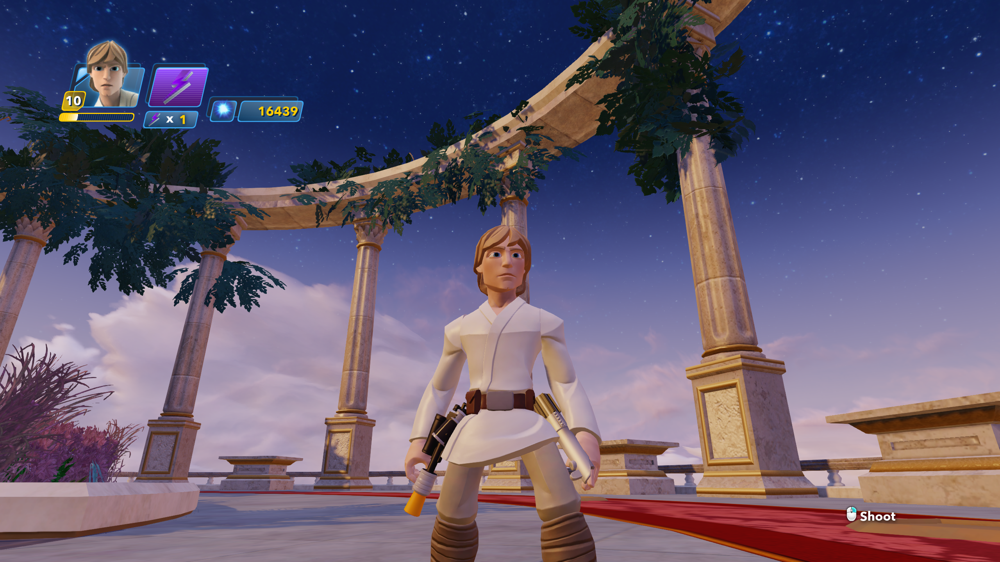
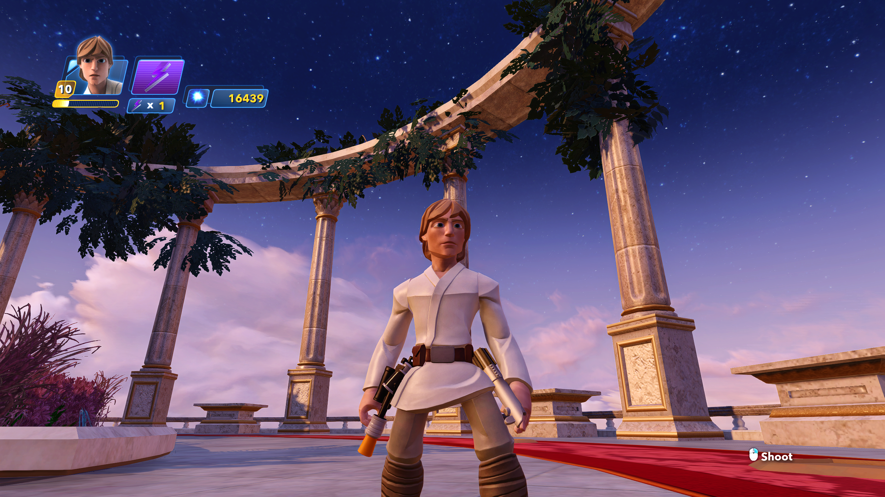

# DI3 DLSS 5: machine setup and configuration

This guide accompanies the experimental CrabeLoader mod for **Disney Infinity 3.0 Gold Edition on Windows**. Follow it before judging image quality or performance. Paths below use `<game>` for the folder containing `DisneyInfinity3.exe` and `<repo>` for this mod's source checkout. Substitute your own locations.

## What has actually been tested

The development machine has an **RTX 4070**, NVIDIA driver **616.56**, and a 2560x1440 SDR game configuration. These are reference conditions, not a minimum specification or a required driver version. The integration uses a 32-bit game addon and a separate 64-bit helper with matching dependencies.

Neural feature 18 creation/evaluation was verified in earlier sessions. Disabling NVIDIA's global background frame cap removed a fixed 30 FPS ceiling: gameplay screenshots showed 69 FPS and sampled client logs about 68-78 FPS. **Fresh neural engagement was not confirmed in that faster helper session because its ReShade log was stale.** Treat these as separate findings; this guide does not promise 60 FPS with neural rendering on every machine or in every scene. RTX 50-series hardware has not been tested here.

Use the versions pinned by `sources.lock.json` when reproducing this setup. The tested RTX 40 configuration uses a community-compatible neural runtime; do not assume an arbitrary DLL from another DLSS package is interchangeable. Download provenance and component notices are recorded in the repository's `docs/THIRD-PARTY.md` and lock file.

## 1. Prepare the game and required tools

You need:

- Disney Infinity **3.0 Gold Edition**, using `DisneyInfinity3.exe` (32-bit D3D11).
- The CrabeLoader fork's `fix/reshade-hosting` implementation, including the custom addon/depth bridge from commit `0977b9c` or a compatible successor.
- The custom **32-bit** `Crabe/ReShade32.dll` described below. A normal full-addon ReShade installer alone does not supply this manual-hosting integration.
- Python 3.11 or newer for the source package's assembly/installation scripts; they use the standard library.
- An NVIDIA GPU/runtime combination supported by the selected neural runtime. The package's locked RTX 40 runtime was evaluated on the RTX 4070; compatibility with other hardware needs its own validation.

If building the custom DLL yourself, also install Git for Windows and Visual Studio 2022/Build Tools with **Desktop development with C++**, MSVC v143 and a Windows SDK. Initial assembly/build downloads need internet access. You do not need these C++ build tools merely to use an already-built compatible custom DLL.

Before installation, close the game and helper and back up `ReShade.ini`, your current preset, shader folders and existing loader files. The installer creates its own backup too. Keep your other shader packages if your preset uses them.

### Build the custom ReShade DLL

From the matching **CrabeLoader fork checkout**, run:

```powershell
& .\tools\reshade\build.ps1
```

The script pins official ReShade 6.8.0 commit `18deaa52de0c425a78b329e9cb3c497281cd00ec`, applies the fork's manual-addon patch and native depth capture, then builds Release/Win32. Deploy:

```text
<CrabeLoader checkout>/build/reshade-manual-addons/ReShade32.dll
    -> <game>/Crabe/ReShade32.dll
```

CrabeLoader itself must also contain the matching updated hosting bridge. Its build/deployment instructions and detailed companion DLL guide live in the fork, particularly `docs/guides/reshade.md`. The DLSS mod installer checks the custom DLL's capability export but does not build or replace the loader or custom DLL.

If a previous ordinary ReShade installation left a graphics proxy such as `d3d11.dll` or `dxgi.dll` in the **game root**, disable only that known ReShade proxy before using this route. Do not rename system DLLs or another mod's graphics wrapper. The helper's own `native/host64/dxgi.dll` is required and must stay in place. Check the filename is exactly `ReShade32.dll`, without an extra dot or hidden duplicate extension.

## 2. Configure NVIDIA background pacing first

**This was the decisive setting for the fixed 30 FPS problem on the test machine.** The neural helper runs in the background. A driver background frame cap can pace the helper at 30 FPS even while the foreground game runs much faster with Feed disabled.

1. Open **NVIDIA Control Panel**.
2. Select **Manage 3D settings -> Global Settings**.
3. Find **Background Application Max Frame Rate**.
4. Record its current value, set it to **Off**, and click **Apply**.
5. If a helper is already running, use ReShade's **Restart the DLSS 5 host** button for a fresh comparison. You do not need to repeatedly restart the whole game to test this setting.

This is the **background** limiter, not ordinary Max Frame Rate and not Vertical Sync. The NVIDIA App may expose similarly named settings; the reproducible diagnostic instruction here is the Control Panel global setting. It affects other background 3D applications too. Keep a note of your prior value if you want to restore it after using the mod.

### Why the global setting matters in this setup

A helper-specific Background Application Max Frame Rate **Off** exception was displayed in NVIDIA App, but gameplay and an isolated background D3D12 test still ran at 30 FPS. Turning helper VSync Off did not resolve that ceiling either. Only the global background-Off comparison removed the measured wait: approximately **33.06 ms to 0.45 ms** per native Present in the isolated test. Why the per-program exception was ineffective remains unresolved.

Do not assume a displayed program exception is effective: check actual gameplay and fresh logs. If you need the global background limit for other software, a reliable per-helper exception remains a separate configuration problem; this project has not established one yet.

### Afterburner, RTSS and ordinary frame limits

**MSI Afterburner and RTSS can remain running.** They remained running when the global background-cap change removed the ceiling. Their presence alone does not establish a fault.

Check that your game-specific RTSS and driver foreground limits permit your target FPS. Choose your own sensible foreground limit; 141 FPS was the user's setting during testing, not a required value. VSync Off and a helper-only RTSS detection exclusion were tried and did not fix the 30 FPS ceiling. Do not copy all historical diagnostic overrides as prerequisites or disable all overlays indiscriminately.

## 3. Assemble and install the mod

From `<repo>`, for the pinned public RTX 40 runtime:

```powershell
python .\scripts\package.py prepare
python .\scripts\package.py test
python .\scripts\package.py install --game 'PATH_TO_YOUR_GAME_FOLDER'
```

Replace the example game path. If using your own compatible `nvngx_dlssnr.dll`, replace the prepare command with:

```powershell
python .\scripts\package.py prepare --nr 'C:\path\to\compatible\nvngx_dlssnr.dll'
```

The default uses the locked public RTX 40 310.8 runtime. The development installation subsequently used a user-provided FP16 310.9.16/CUDA13.4.3 runtime; that user's file is not a public distribution artifact of this repository. Assembly records its hash/provenance when overridden.

Keep the game/helper closed for install, uninstall or binary replacement. Installation refuses an existing mod package and conflicting external-addon search paths. Back up tuned settings before using uninstall/reinstall for an upgrade. Do not bypass that check by overwriting a live installation.

The installer configures ReShade's preset and addon/shader search paths. Copying only `mods/di3-dlss5` is insufficient. The game addon must be `.addon32`; the helper, its ReShade and RenoDX are 64-bit. Preserve the matched package layout instead of mixing arbitrary releases.

## 4. Enable and verify it in gameplay

Enter an actual 3D scene, press **Home**, and check:

| Location | Expected configuration |
| --- | --- |
| Home -> preset | `DI3-DLSS5` |
| Home -> effects | `Lumenite_Kernel` enabled and above `DLSS5_Feed`; both enabled |
| Preset preprocessor definition | `DLSS5_MV_PROVIDER=3` for the supplied Lumenite Kernel provider |
| Add-ons -> Generic Depth | Main scene depth buffer detected; not an empty buffer list |
| Add-ons -> DLSS 5 Feed | Enabled; host running; delivered frame count increasing |
| Neural settings | Enable DLSS Neural Rendering checked; apply host settings if changed |

Reference starting point: full DLSS path, work resolution 100%, SDR, one neural pass, upscaling disabled. The tested depth orientation was reversed=1, upside-down=0, logarithmic=0. Use DisplayDepth temporarily to verify geometry/depth, then disable it for normal play. If scene depth disappears before effects run, the Generic Depth copy-before-clears setting is worth testing separately. Do not tune depth orientation just to compensate for an entirely missing depth resource.

The Lua CrabeLoader entry announces the mod; it does not unload the native ReShade addon. Use Feed's Enabled checkbox for comparisons. An exclusive fullscreen game may keep the helper's separate panel/window hidden; the Feed controls in the game's ReShade overlay are the normal place to configure it.

### Prove neural rendering rather than just an enabled checkbox

Preserve these logs before restarting; subsequent sessions can overwrite them:

```text
<game>/mods/di3-dlss5/native/dlss5-feed.log
<game>/mods/di3-dlss5/native/host64/dlss5-feed-host.log
<game>/mods/di3-dlss5/native/host64/ReShade.log
```

Require evidence of **feature 18 creation/evaluation** and **`state=ENGAGED`** for the **current helper session**. Confirm log timestamps are after that helper started. A stale ENGAGED line from an earlier process is not current evidence. `DLAA`, frames delivered, Enable checked, or higher FPS alone do not prove the neural consumer is running.

If the current host reports `consumer did not intercept`, or feature creation fails, do not label the faster result a neural benchmark. Preserve logs, use the host restart control for recovery, and recheck fresh evidence. Resolution/mode changes produced live rebuild failures in testing; establish a clean baseline before experimenting with them.

Compare Feed on/off in the same scene with the overlay closed, then test movement and scene transitions. Record sustained FPS and frame times, not just one screenshot. A 60 FPS minimum across scenes remains a validation target, not a hardware-independent promise.

## 5. Optional: reproduce the brighter visual look

The basic mod preset enables Kernel and Feed. **Tonemap, CAS, FakeHDR and Vibrance are optional additional ReShade shaders** from the user's existing shader installation; the base package does not supply the complete personal look or every third-party shader. Install matching shader packages if you import a preset that uses them.

### Before and after: the combined visual preset

These are the user's supplied before/after captures. **The after image combines DLSS 5 with additional ReShade effects: Tonemap, CAS sharpening, FakeHDR and Vibrance.** It illustrates the complete preferred look; the visible changes cannot be attributed to DLSS 5 alone. The captures are separate frames with small pose/HUD differences, rather than a synchronized comparison.

**Before**



**After - DLSS 5 plus additional ReShade effects**



The screenshots are preserved as supplied, without cropping or color edits. Use the optional settings below as a starting point for your own preference.

The user's saved effect order was:

1. Lumenite Kernel
2. DLSS 5 Feed
3. Tonemap
4. AMD FidelityFX Contrast Adaptive Sharpening (CAS)
5. HDR (`FakeHDR.fx`, an artistic effect, not a switch to HDR output)
6. Vibrance

For a lighter final image, enable **Tonemap after Feed**. The approved saved values were Exposure **0.202**, Gamma **1.00**, Bleach **0.03**, Saturation **0**, Defog **0**. Exposure directly brightens the image; Bleach also lifts shadows and fades colors. These are a preference starting point, not a required DLSS correction. They affect the HUD too, and excessive brightening can wash out highlights.

Global Tone Intensity 1.00 -> 0.80 made little visible difference for this user's brightness issue. It controls neural tone strength, not direct exposure. Diffuse White (nits) is ignored by this Feeder's SDR bridge and is not a brightness fix for this SDR setup. Do not change driver settings to adjust artistic brightness.

## 6. Save and restore your complete appearance

Turn **Auto Save** on in the ReShade Home tab. The preset saves all effect parameters, enabled techniques, order and preset definitions, not only DLSS settings. For a restorable local backup, save:

- `<game>/ReShade.ini`
- The active preset shown by `PresetPath` (normally `mods/di3-dlss5/DI3-DLSS5.ini`)
- `mods/di3-dlss5/native/dlss5-feed.cfg`
- `mods/di3-dlss5/native/host64/ReShade.ini`
- All shader and texture directories referenced by the main ReShade configuration.

A preset alone cannot restore missing shader files. Keep local third-party shader backups private unless their distribution terms permit sharing. The development user's complete backup is local-only; it is not bundled with the public mod source.

Restore with the game/helper closed and back up current files first. Keep the required loader/native runtimes installed. NVIDIA and RTSS settings live outside these files: restoring a preset does not restore machine-level frame-cap settings.

## Troubleshooting quick reference

| Symptom | Check / next action |
| --- | --- |
| ReShade never appears | Custom DLL path/name, matching Crabe bridge, duplicate root ReShade proxy; consult the Crabe fork guide. |
| Add-ons tab is empty | Stock manual-runtime DLL is insufficient; use the custom addon-capable build. |
| Generic Depth has no buffers; DisplayDepth flat purple/white | Verify custom native depth capture, then test in a 3D scene. Slider changes cannot create missing depth events. |
| Feed on exactly30FPS; Feed off much faster; GPU not fully busy | Check **global Background Application Max Frame RateOff** first; verify actual behavior after Apply. Low GPU utilization alone does not identify the cause. |
| Faster FPS but no visible neural change | Verify current-session feature18/ENGAGED and investigate interception/build failures. |
| NGX `0xBAD00000` after resolution/mode changes | Preserve logs, return to the recorded baseline, restart the helper and verify neural status. Some earlier faster intervals were fallback. |
| Image darker than preferred | Add optional Tonemap after Feed; adjust exposure gradually. |
| Missing optional effect on another machine | Install its shader package and check effect/texture search paths; preserve the whole preset and dependencies. |

For maintainers, `docs/TROUBLESHOOTING.md` in the source repository is the full experiment record. Record machine/GPU/driver, active preset and dependency versions, background/foreground caps, current helper start time, fresh logs and measured FPS before changing another variable. Change one setting at a time and retain a rollback path.
